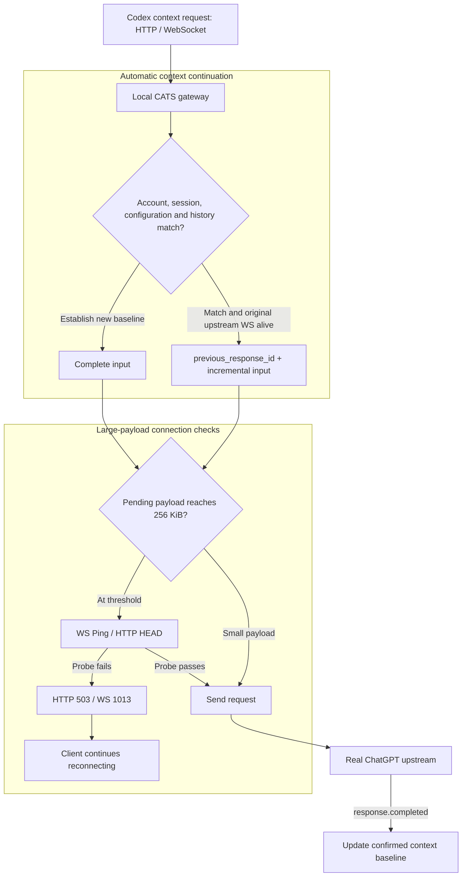

# Codex Against Traffic Spam (CATS)

<p align="center">
  
</p>

<p align="center"><strong>Save your Codex proxy traffic</strong></p>

<p align="center">
  
  
  <a href="LICENSE"></a>
</p>

<p align="center">
  <a href="README.md">中文</a> ·
  <a href="README.macos.md">macOS preview</a> ·
  <a href="experiments/RESULTS.macos.md">Experiment report</a> ·
  <a href="#installation-and-use">Installation and use</a>
</p>

CATS is an experimental local gateway companion for the official Windows Codex Desktop, with a macOS source preview. It combines server-confirmed context reuse with connection probes to reduce repeated uploads of multimodal context and messages, saving bandwidth and proxy traffic.

## Why CATS?

When a long conversation resends its complete history, the same multimodal context consumes proxy traffic again. CATS applies one continuation policy to HTTP and WebSocket context requests. Matching accounts, sessions, configuration and history can use `previous_response_id + incremental input`; other requests send their complete input to establish a new baseline.

Reconnections, transport fallback, session recovery and other events can trigger repeated uploads of historical images and file content. CATS handles these repeated-upload scenarios across HTTP and WebSocket, evaluating request content against confirmed server context. Eligible requests send deltas, and larger payloads receive a connection check before sending.

## Capabilities

- **Automatic context continuation:** Codex can trigger unnecessary full-context uploads in some situations. CATS applies the same strict continuation checks to HTTP and WebSocket requests, reusing completed context on the same live upstream connection.
- **Large-payload connection checks:** unstable connections can lead to repeated uploads during retries that still consume proxy traffic. CATS runs WS Ping or HTTP HEAD probes before larger sends. Failed probes return a retry signal so the client can reconnect.

## Windows measurement: about 10.8 MB of image context

A paired experiment used **three different PNGs**, totaling about **10.8 MB of Base64 context**, to compare native request forwarding and CATS across connection interruption, recovery and subsequent requests. Each arm completed four generations.


| Metric | Native requests via relay | CATS | **Upload reduction** |
| --- | ---: | ---: | ---: |
| Observed proxy-path upload (TLS + CONNECT) | 32.44 MB | 16.55 MB | **48.97%** |
| Canonical JSON payload for completed generations | 43.23 MB | 21.58 MB | **50.07%** |
| Third-generation JSON payload | 10,822,938 B | 2,480 B | **99.98%** |
| Fourth-generation JSON payload | 10,824,191 B | 2,505 B | **99.98%** |

## macOS traffic and historical-image reuse measurement

Two paired runs per scenario used the installed official Mac core and real upstream, comparing stable networking and a 12-second outage after the first turn:

| Capability | Result | Scope |
| --- | --- | --- |
| Overall context continuation | Mean outage proxy upload: 57.47 MB → 37.63 MB, **34.527% less** | Stable native WS was essentially unchanged; individual outage pairs saved 41.66% / 27.39% |
| Historical-image reuse (image filtering) | Five eligible requests: about 10.9 MB → 2 KB each, about **99.98% less application payload**; three historical image bodies were not resent per request | Not image compression; first uploads and new baselines remain complete |

All 32 formal turns completed, with 24/24 image-recall and 24/24 dynamic-tool checks passing; 37 offline regressions passed. These are whole-run and eligible-request views of the same experiment, not additive savings.

See the [full report](experiments/RESULTS.macos.md) for methods, raw statistics, observer corrections and limits. Bytes were counted from the local relay to the existing proxy, including CONNECT/TLS; this was not Desktop GUI validation, WAN/NIC capture or a login-cycle test. CPU, memory and first-image timing were not separately benchmarked. macOS remains experimental.

## How it works



Context baselines stay in memory. When a client connection changes, CATS checks the existing upstream connection and baseline. A rebuilt upstream connection establishes a fresh baseline through complete input, then evaluates subsequent requests for continuation.

Health probes describe connectivity at the time of the check. Failed probes return HTTP 503, or a WebSocket error followed by close code 1013, allowing the client to reconnect. Requests over 12 MiB may prepare context using batched `generate=false` warmups. A CATS-generated delta explicitly rejected with `previous_response_not_found` in the first upstream event receives one full retry.

HTTP-to-WebSocket conversion adapts the transport envelope. Other native endpoints retain their request paths, and HTTP requests with body-bound signatures use native forwarding. Complete image content and historical input form the basis for forwarding and continuation checks.

## Installation and use

### Windows x64

**Requirements:** Windows x64, PowerShell 5.1+, Git; official Codex Desktop signed in through ChatGPT with the default OpenAI provider; a direct connection or credential-free HTTP(S) proxy.

Run in PowerShell:

```powershell
git clone https://github.com/Khiyyya/codex-cats.git
cd codex-cats
powershell.exe -NoProfile -ExecutionPolicy Bypass -File .\scripts\windows.ps1 -Action install
```

The installer prepares a dedicated Python environment, discovers Codex, and configures the gateway and current-user login startup. Restart Codex after installation.

### macOS preview

Requires a Codex/ChatGPT app containing the Codex core, ChatGPT login, and a stable Python 3.11+ installation. Double-click `INSTALL-MAC.command` in this source checkout, or run:

```bash
bash scripts/macos.sh install
```

macOS uses a private venv that still depends on its base Python, with a per-user LaunchAgent for background startup. Restart an already-open Codex after installation. See the [macOS guide](README.macos.md) for paths, proxies, stopping and removal.

### Management commands

Run the corresponding file from the project or installation directory:

| Windows entry | macOS entry | Function |
| --- | --- | --- |
| `INSTALL.cmd` | `INSTALL-MAC.command` | Install (Windows also supports updates) |
| `OPEN-CODEX.cmd` | `OPEN-CODEX-MAC.command` | Start the gateway and open Codex |
| `START-GATEWAY.cmd` | `START-GATEWAY-MAC.command` | Start the gateway and enable integration |
| `STOP-GATEWAY.cmd` | `STOP-GATEWAY-MAC.command` | Restore integration configuration and stop the gateway |
| `STATUS.cmd` | `STATUS-MAC.command` | Show status and application-payload statistics |
| `DOCTOR.cmd` | `DOCTOR-MAC.command` | Check environment, autostart and proxy connectivity |
| `UNINSTALL.cmd` | `UNINSTALL-MAC.command` | Restore configuration and remove integration (Windows cleans the installation directory) |

After stopping or uninstalling, restart Codex to load the restored configuration. On macOS, uninstall removes integration but retains the private runtime and configuration backups; see the macOS guide for manual cleanup after successful removal.
