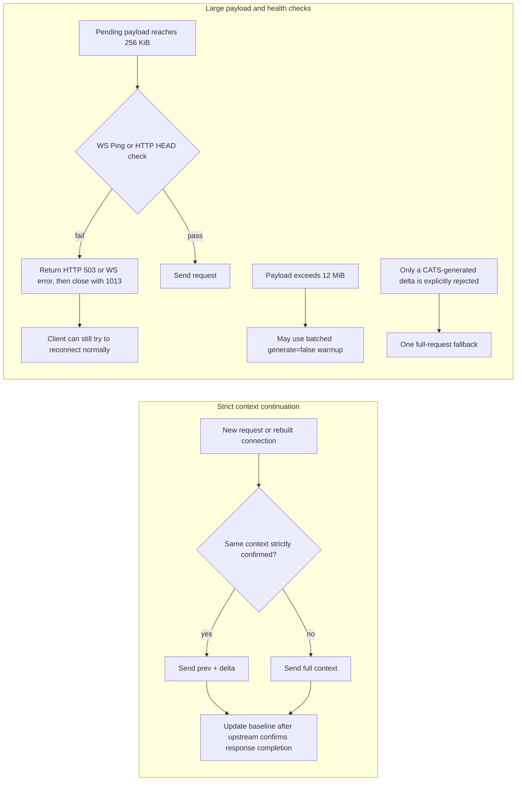

# Codex Against Traffic Spam (CATS)

[中文](README.md)

> Let the big cat carry fewer boxes of context, without guessing what comes next.

CATS is a local gateway companion for Windows x64. It identifies context that can be safely continued in model traffic from the official Codex Desktop and reduces repeated large uploads. It is experimental and **not an official OpenAI gateway, plugin, or product**. The default installation exposes an entry point only on the local loopback address and then connects to the real upstream; whether it saves traffic depends on whether the context can actually be continued.

## Read this first

- The goal is to reduce repeated large context payloads. CATS does not promise a general speedup or general savings.
- A native short disconnect may already recover through a WebSocket continuation, so CATS does not provide additional gains in every network environment.
- The test used a real installed `codex.exe` core and a real ChatGPT upstream, but the test path was an isolated observation relay, **not an end-to-end Desktop GUI test**.
- CATS does not record chat images or account tokens. Local metrics record statistics such as sizes, counts, transport and reasons. Installation state stores a local random gateway token. Configuration backups used for recovery may contain user configuration and should be treated as private files.

## Installation

1. Install the official Codex Desktop on Windows x64 and sign in with a ChatGPT account.
2. Download this project's ZIP and extract it to a local directory.
3. Double-click `INSTALL.cmd`.

The installer does not require system Python and does not change the system PATH, proxy, or certificates. It registers a CATS-owned startup entry and scheduled task for the current user. In the local installation directory it uses fixed versions and SHA-256 verification for a self-contained embedded Python 3.14.9 and pip, then installs fixed dependencies from PyPI. The runtime is installed with the project and does not depend on a shared Python installation that may be upgraded or removed.

The fixed dependencies are `aiohttp 3.14.5`, `websockets 16.1.1`, `zstandard 0.25.0`, `tomlkit 0.13.3`, `multidict 7.1.0`, and `yarl 1.25.1`.

After a first installation into an existing Codex setup, restart Codex once so the already-open process loads the new configuration. Installation enables login startup and task recovery, but the real logoff/logon cycle has not been verified and CATS does not intercept every Codex startup action. Use `START-GATEWAY.cmd` or `OPEN-CODEX.cmd` when needed. `OPEN-CODEX.cmd` starts the gateway before opening Codex. The source directory and the local installation directory provide the same command entry points.

The installer refuses to configure a custom provider, profile/base URL, an `OPENAI_BASE_URL` override, PAC, SOCKS, or a proxy with embedded credentials. A detected existing HTTP(S) proxy without credentials is reused; the original proxy and certificates are not modified.

## Command entry points

| File | Purpose |
| --- | --- |
| `START-GATEWAY.cmd` | Start the local gateway |
| `STOP-GATEWAY.cmd` | Stop the local gateway |
| `OPEN-CODEX.cmd` | Start the gateway, then open Codex |
| `STATUS.cmd` | Show application-layer status, gateway health, and a metrics summary |
| `DOCTOR.cmd` | Run diagnostics |
| `UNINSTALL.cmd` | Stop and uninstall, restoring the original Codex configuration |

`STATUS.cmd` reports application-layer state, not proof of network reachability. After running `STOP-GATEWAY.cmd` or `UNINSTALL.cmd`, restart Codex if it was already open so the restored configuration takes effect.

## Failure recovery

Installation first downloads the runtime in an isolated staging directory, installs dependencies, and runs import and desktop-command smoke tests. If dependency installation or a smoke test fails, an existing installation is not replaced. If commit or activation fails, the installer attempts to restore the old runtime and configuration.

Automatic recovery can itself be affected by file locks or permissions. If recovery fails, the installation directory is retained for diagnosis; do not treat that state as a successful installation. Run `DOCTOR.cmd` first and keep the diagnostic information in that directory. Configuration backups may contain user configuration and should be treated as private before sharing.

## Context continuation rules

Only when the account and session are the same, the model and tool configuration match, the history matches strictly, and the same upstream WebSocket is still alive with the previous response confirmed complete, CATS sends `previous_response_id +` incremental `input`. When it cannot confirm those conditions, it sends the full context. For complete history resubmitted by the client, the first request after a connection is rebuilt must still be full; CATS does not count the original request's `previous_response_id` as a saving. The server is not guaranteed to reuse a cache across connections.

A health check proves connectivity only at the time of the probe and cannot guarantee that the following send will succeed. When a probe fails, CATS returns HTTP 503 or sends a WebSocket error and closes with code 1013. It does not prevent the client from reconnecting and does not automatically append a full upload. HTTP probes use a bodyless HEAD; requests with body-bound signatures are not probed or rewritten. Requests over 12 MiB may need batched `generate=false` warmup. CATS performs one full retry only when a delta generated by CATS itself is explicitly rejected with `previous_response_not_found` in the first upstream event; it does not blindly retry uncertain outcomes.

These probes, warmups, and retries after explicit rejection are intentional protocol operations. Apart from them, native HTTP forwarding does not add compression, cookies, automatic redirects, or extra body data. HTTP-to-WebSocket conversion changes the transport envelope, so equivalent behavior is not guaranteed for every arbitrary request header, unknown WebSocket control message, or subprotocol; compatibility still has limits. Context baselines remain in memory only. Expiration, restart, or connection loss discards reuse; CATS does not save traffic by deleting historical images.

## One isolated measurement

The following results come from a paired experiment: each arm ran once, using the same three different PNGs (about 10.8 MB of Base64 context in total), for four generations; the upstream was isolated for 12 seconds after the first generation. WebSocket was not forcibly disabled. Both arms naturally fell back to HTTP, all four generations succeeded, three tool calls succeeded, and the color-block recall checks passed.

- TLS + CONNECT bytes on the local machine's Clash path: native `32,448,069 B`, CATS `16,552,747 B`, a `48.99%` reduction. This includes handshakes, retries, and compression differences. It is an observation of the local-machine-to-Clash path, not a WAN or NIC traffic conclusion.
- Decompressed application payload across four completed generations: native `43,226,206 B`, CATS `21,584,403 B`, about a `50.07%` reduction. The client still gives the complete HTTP request to local CATS; the saving occurs between CATS and the upstream. HTTP request bodies use zstd, and the upstream WebSocket negotiates permessage-deflate. Uncompressed payload size must not be treated as on-wire bytes.
- The last two delta payloads were `2,479 B` and `2,504 B`. The first request after rebuilding the connection was still full; subsequent requests could convert the client's complete HTTP request into a delta on the same upstream WebSocket.
- A native short disconnect may also recover a WebSocket delta by itself, so this one paired result cannot be generalized to a fixed gain in every network environment.

The experiment used the official installed `codex.exe` core and a real ChatGPT upstream. The test harness was an isolated relay and must not be treated as equivalent to Desktop GUI validation. A simulated-server test can pass, but it does not replace GUI validation.

| Metric | Native Codex | CATS |
| --- | ---: | ---: |
| Proxy-path upload (TLS + CONNECT) | 32.45 MB | 16.55 MB |
| Decompressed application payload for completed generations | 43.23 MB | 21.58 MB |
| Third-generation application payload | 10,822,838 B | 2,479 B |
| Fourth-generation application payload | 10,824,091 B | 2,504 B |
| Completed generations / image-recall check | 4 / passed | 4 / passed |

All MB values above are decimal. An offline failed connection attempt is not proof that a complete body was uploaded to the server. The native first generation already used its own `previous_response_id`; it is not counted as a CATS advantage. One paired experiment cannot establish long-term savings or fully equivalent quality.

## Validation scope

**Simulated-server validation passed:** strict continuation, cross-transport reuse, isolation, fallback, and fidelity regressions; this does not represent every behavior of the official service.

**Real official environment validation passed (core program, not GUI):** the HTTP/WS paths, tool calls, connection-failure recovery, and three-image historical color-block recall from the paired experiment above.

The current build and offline validation passed: 131 automated tests, PowerShell offline checks, installation of the wheels into a fresh embedded Python 3.14.9 runtime, module imports, `pip check`, and `python -m uplink12.desktop --help`.

**Not yet validated:** native History UI search and image reading, real account switching, the new-install end-to-end flow, logging out and signing in again, and subjective output quality. Treat these as unpromised behavior.

## Privacy and boundaries

- The local entry point uses plain HTTP on loopback with a random mount token. This prevents ordinary accidental connections but does not isolate it from a malicious process on the same machine.
- CATS does not record chat text, images, account tokens, or Cookies. Metrics contain only payload sizes, counts, transport and reason statistics, and similar bounded fields. Installation state stores the local random gateway token and must be treated as private data.
- Installation backups are used to restore the Codex configuration and may contain user configuration. Treat them as private data.
- CATS does not change the system proxy or certificates and does not automatically rewrite a custom provider, base URL, PAC, SOCKS, or credential-bearing proxy into a usable configuration.

## License and assets

The code license is in [LICENSE](LICENSE); MIT applies to the code only. `assets/cat.png` is a user-provided original image whose source and licensing status are still unconfirmed. The cat image is not declared MIT-licensed with the code.
