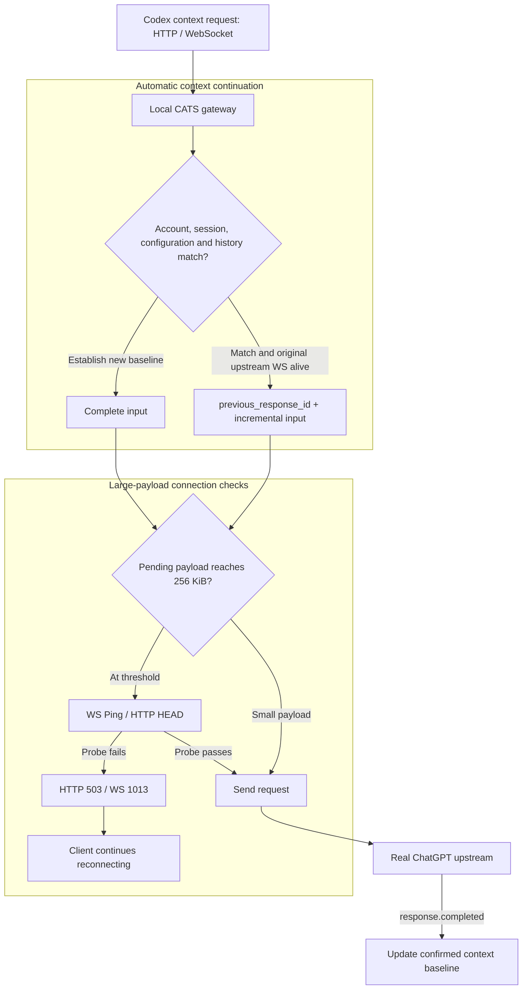

# Codex Against Traffic Spam (CATS)

  

<strong>Save your Codex proxy traffic</strong>

  
  
  

  <a href="README.md">中文</a> ·
  <a href="https://github.com/Khiyyya/codex-cats/releases">Download preview</a> ·
  <a href="#installation-and-use">Installation and use</a>

CATS is an experimental local gateway companion for the official Windows Codex Desktop. It reuses server-confirmed context to reduce repeated uploads of historical images and messages.

## Why CATS?

When a long conversation resends its complete history, the same Base64 images consume proxy traffic again. CATS applies one continuation policy to HTTP and WebSocket context requests. Matching accounts, sessions, configuration and history can use `previous_response_id + incremental input`; other requests send their complete input to establish a new baseline.

Codex already supports native WebSocket continuation. CATS extends coverage to a path observed in testing: after reconnecting, the client falls back to HTTP and keeps submitting complete history. CATS maintains an upstream WebSocket so subsequent requests can continue reusing context.

## Capabilities

- **Automatic context continuation:** HTTP and WebSocket share strict continuation checks against completed context on the same live upstream connection.
- **Large-payload connection checks:** WS Ping or HTTP HEAD probes run before larger sends. Failed probes return a retry signal so the client can reconnect.
- **Complete-input fallback:** rebuilt connections and changed baselines send full history. An explicitly rejected continuation reference receives one protocol-defined full retry.
- **Automatic runtime setup:** the installer downloads and verifies a dedicated Python runtime, installs dependencies for the current user, discovers Codex and initializes integration.
- **Existing proxy support:** direct connections and detected credential-free HTTP(S) proxies work with the existing system proxy and certificate configuration preserved.

## Measurement: about 10.8 MB of image context

A paired experiment on 2026-10-22 used **three different PNGs**, totaling about **10.8 MB of Base64 context**. Each arm completed four generations. The isolated upstream path was interrupted for 12 seconds after the first generation.

Both arms naturally fell back to HTTP, completed three sequential tool calls, and identified the center-square colors in the historical images. The model derived the answers from the images.

| Metric | Native requests via relay | CATS | Observed change |
| --- | ---: | ---: | ---: |
| Observed proxy-path upload (TLS + CONNECT) | 32.44 MB | 16.55 MB | 48.97% reduction |
| Canonical JSON payload for completed generations | 43.23 MB | 21.58 MB | 50.07% reduction |
| Third-generation JSON payload | 10,822,938 B | 2,480 B | Incremental continuation |
| Fourth-generation JSON payload | 10,824,191 B | 2,505 B | Incremental continuation |
| Completed generations / image-color check | 4 / passed | 4 / passed | Both completed |

### Measurement scope

- **Link bytes:** counted on the local-machine-to-Clash observation path, including TLS, CONNECT, handshakes, retries and compression differences. Exact totals: `32,438,227 B → 16,552,902 B`.
- **Application payload:** compact UTF-8 JSON, totaling `43,226,845 B → 21,584,719 B`. HTTP request bodies used zstd; upstream WebSocket negotiated permessage-deflate. MB values are decimal.
- **Control path:** both arms reached the real ChatGPT upstream through an observation forwarder. The control arm forwarded native requests, with WebSocket compression negotiated by the forwarder. The gateway used Python 3.12.14; official core `0.163.0-alpha.11`, Desktop `26.1016.6573.0`, model `gpt-6-astra` with low reasoning.
- **Where savings occur:** the client still submits complete HTTP requests to local CATS. After the rebuilt upstream connection receives a full request and establishes a baseline, two subsequent requests become deltas. Savings occur between CATS and the upstream.

The native first generation used its own `previous_response_id`. The additional savings shown here come from converting subsequent full HTTP history into deltas in this single paired experiment.

## How it works

Context baselines stay in memory. When a client connection changes, CATS checks the existing upstream connection and baseline. A rebuilt upstream connection establishes a fresh baseline through complete input, then evaluates subsequent requests for continuation.

Health probes describe connectivity at the time of the check. Failed probes return HTTP 503, or a WebSocket error followed by close code 1013, allowing the client to reconnect. Requests over 12 MiB may prepare context using batched `generate=false` warmups. A CATS-generated delta explicitly rejected with `previous_response_not_found` in the first upstream event receives one full retry.

HTTP-to-WebSocket conversion adapts the transport envelope. Other native endpoints retain their request paths, and HTTP requests with body-bound signatures use native forwarding. Complete image content and historical input form the basis for forwarding and continuation checks.

## Installation and use

### Integration requirements

- Windows x64 with the official Codex Desktop installed and signed in through a ChatGPT account.
- Default OpenAI provider configuration; the installer checks existing configuration before integrating.
- A direct connection or a credential-free HTTP(S) proxy.

### Install

1. Download `codex-cats-12.2.0.zip` from [Releases](https://github.com/Khiyyya/codex-cats/releases) and extract it.
2. Run `INSTALL.cmd`. The installer prepares the private runtime, checks dependencies, discovers Codex, and configures the gateway and current-user startup entry.
3. Restart an already-open Codex process to load the integration configuration.

Use `OPEN-CODEX.cmd` to start the gateway before opening Codex. Installation also configures a current-user login entry and an independent scheduled task.

Runtime and dependencies

The installer downloads and verifies Python 3.14.9 and pip 26.2.2, then prepares build tools and project dependencies in a staged runtime.

| Category | Fixed versions |
| --- | --- |
| Build tools | setuptools 84.2.1, wheel 0.48.0 |
| Gateway | aiohttp 3.14.5, websockets 16.1.1, zstandard 0.25.0 |
| Configuration and URLs | tomlkit 0.13.3, multidict 7.1.0, yarl 1.25.1 |

Source builds use the prepared staged runtime. Dependency and startup checks finish before runtime replacement and configuration activation.

### Management commands

The extracted package and installation directory provide these entry points:

| Script | Function |
| --- | --- |
| `OPEN-CODEX.cmd` | Start the gateway and open Codex |
| `START-GATEWAY.cmd` | Start the gateway and enable integration |
| `STOP-GATEWAY.cmd` | Restore integration configuration and stop the gateway |
| `STATUS.cmd` | Show gateway status and application-payload statistics |
| `DOCTOR.cmd` | Inspect environment, startup and proxy connectivity |
| `UNINSTALL.cmd` | Restore integration configuration, remove startup entries and clean the installation directory |

After stopping or uninstalling, restart an already-open Codex process to load the restored configuration. Restoration handles settings managed by CATS while preserving subsequent user edits.

### Installation recovery

Installation uses staging, validation, replacement and activation. Dependency and startup checks finish before replacing an existing runtime. Replacement or activation errors trigger an attempt to restore the previous runtime and configuration, retaining recovery files for further handling. `DOCTOR.cmd` inspects an existing installation.

## Validation progress

| Layer | Completed validation |
| --- | --- |
| Simulated servers and automation | 131 regressions pass under Python 3.12.14 and embedded 3.14.9, covering strict continuation, cross-transport reuse, isolation, fallback and request fidelity |
| Real upstream and official core | The four-generation paired experiment above, including HTTP/WS paths, tool calls, connection recovery and historical-image color checks |
| Shipping runtime | Python 3.14.9 source/wheel installation, imports, dependency checks, command entry points and a real-upstream small-text connectivity check |
| Isolated Windows installation | PowerShell 5.1 exit-code/path checks, installation, startup, stopping, byte-for-byte configuration restoration and cleanup; registry and task operations use test doubles |

Next validation targets: Desktop GUI History search and image reading, fresh installation with real registry/task-service integration, Windows login autostart, real account switching and subjective response quality.

## Local data and configuration

The gateway defaults to loopback and uses a random entry token. Metrics record payload sizes, image counts, transports and reuse reasons. The entry token and configuration-recovery backups are stored in the current user's local installation directory.

## Co-author and license

[hadwr](https://github.com/hadwr) is credited as a co-author in the initial commit.

Code uses the [MIT license](LICENSE). The cat image is the user-provided original; source and licensing details are pending.
