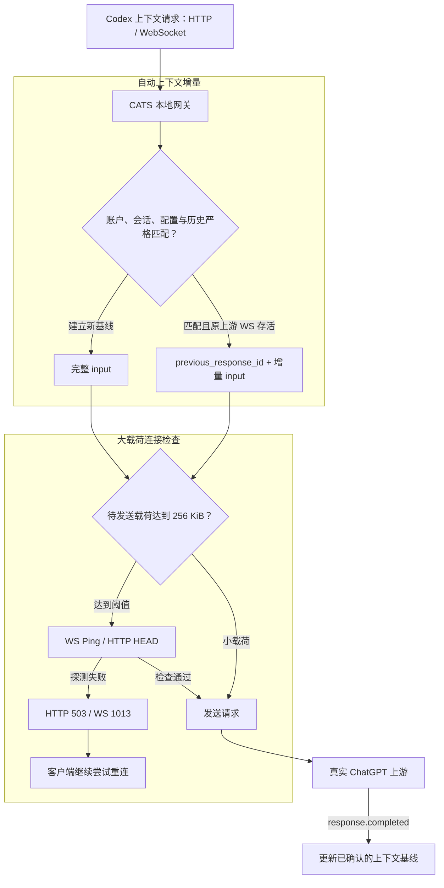

# Codex Against Traffic Spam (CATS)

  

<strong>拯救你的codex代理流量</strong>

  
  
  

  <a href="README.en.md">English</a> ·
  <a href="https://github.com/Khiyyya/codex-cats/releases">下载测试版</a> ·
  <a href="#安装与使用">安装与使用</a>

CATS 是面向 Windows 官方 Codex Desktop 的实验性本地网关伴侣，通过复用服务器已确认的上下文，减少历史图片与消息的重复上行。

## 为什么需要 CATS？

长会话中的完整历史重发，会让相同的 Base64 图片再次占用代理流量。CATS 统一处理 HTTP 与 WebSocket 上下文请求，在账户、会话、配置和历史严格匹配时，把完整请求转换为 `previous_response_id + 增量 input`；其他情况完整转发输入，建立新的上下文基线。

Codex 自身已具备 WebSocket 增量能力。CATS 进一步覆盖了实测中的一种路径：客户端重连后回退到 HTTP，并持续提交完整历史；CATS 通过自己维护的上游 WebSocket，为后续请求继续复用上下文。

## 核心能力

- **自动上下文增量**：HTTP 与 WebSocket 入口共用严格的延续判定，复用同一上游连接中已确认完成的上下文。
- **大载荷连接检查**：发送较大载荷前执行 WS Ping 或 HTTP HEAD；探测失败时返回重试信号，交由客户端继续重连。
- **完整输入回退**：连接重建或基线变化时发送完整历史；明确的增量引用失效按协议回退一次完整请求。
- **自动准备运行环境**：安装器下载并校验独立 Python 运行时，将依赖安装到当前用户目录，自动识别 Codex 并初始化接入配置。
- **沿用现有代理**：支持直连与检测到的无凭据 HTTP(S) 代理，保留现有系统代理和证书配置。

## 实测：约 10.8 MB 图片上下文

2026-10-22 的一组配对实验使用 **3 张不同 PNG**，合计 Base64 上下文约 **10.8 MB**。两组各执行 4 次生成，首代完成后将隔离上游链路中断 12 秒，再继续对话和工具调用。

两组均自然回退到 HTTP，完成 3 次顺序工具调用。模型根据历史图片，正确给出了中心色块的颜色。

| 指标 | 原生请求透传对照 | CATS | 本次变化 |
| --- | ---: | ---: | ---: |
| 代理观测链路上行（TLS + CONNECT） | 32.44 MB | 16.55 MB | 减少 48.97% |
| 已完成生成的规范化 JSON 载荷 | 43.23 MB | 21.58 MB | 减少 50.07% |
| 第三次生成的 JSON 载荷 | 10,822,938 B | 2,480 B | 增量延续 |
| 第四次生成的 JSON 载荷 | 10,824,191 B | 2,505 B | 增量延续 |
| 完成生成 / 图片色块检查 | 4 次 / 通过 | 4 次 / 通过 | 两组完成 |

### 数据口径

- **链路字节**：观测点为本机到 Clash 的转发链路，包含 TLS、CONNECT、握手、重试及压缩差异。精确计数为 `32,438,227 B → 16,552,902 B`。
- **应用载荷**：按紧凑 UTF-8 JSON 统一统计，精确计数为 `43,226,845 B → 21,584,719 B`。HTTP 请求体采用 zstd，上游 WebSocket 协商 permessage-deflate。MB 均按十进制计算。
- **对照路径**：两组都使用观测转发器连接真实 ChatGPT 上游；对照组透传原生请求，WebSocket 压缩由转发器协商。网关运行于 Python 3.12.14，官方核心为 `0.163.0-alpha.11`，Desktop 为 `26.1016.6573.0`，模型为 `gpt-6-astra`（low reasoning）。
- **节省位置**：客户端仍将完整 HTTP 请求交给本地 CATS。上游连接重建后的首个完整请求建立基线，随后两次请求转为增量，节省发生在 CATS 到上游这一段。

原生首代使用了自己的 `previous_response_id`。表中的额外收益来自后续 HTTP 完整历史的增量转换，这组数据展示的是该测试路径下的一次配对结果。

## 工作原理

上下文基线保存在内存中。客户端连接变化时，CATS 检查现有上游连接与基线；上游连接重建后，通过完整输入重新建立基线，再继续判断后续增量。

健康检查反映探测时刻的连接状态。失败时，HTTP 返回 503，WebSocket 返回错误并以 1013 关闭，客户端可继续重连。超过 12 MiB 的请求可能通过分批 `generate=false` warmup 准备上下文；CATS 生成的增量在首个上游事件被明确以 `previous_response_not_found` 拒绝时，完整重试一次。

HTTP 转 WebSocket 会转换传输封装；其他原生端点保留原请求路径。带正文签名的 HTTP 请求使用原生转发路径。完整图片内容与历史输入始终作为转发和延续判定的基准。

## 安装与使用

### 接入条件

- Windows x64，已安装官方 Codex Desktop，并使用 ChatGPT 账号登录。
- 使用默认 OpenAI 提供方配置；安装器检查现有配置后接入。
- 使用直连，或无凭据的 HTTP(S) 代理。

### 安装

1. 从 [Releases](https://github.com/Khiyyya/codex-cats/releases) 下载 `codex-cats-12.2.0.zip` 并解压。
2. 双击 `INSTALL.cmd`。安装器会准备私有运行时、检查依赖、识别 Codex，并配置网关及当前用户启动项。
3. 重启已经打开的 Codex，使接入配置生效。

安装完成后，可通过 `OPEN-CODEX.cmd` 先启动网关，再打开 Codex。安装器还会配置当前用户登录启动项与独立计划任务。

运行时与依赖

安装器自动下载并校验 Python 3.14.9 与 pip 26.2.2，在暂存运行时中准备构建工具和项目依赖。

| 类别 | 固定版本 |
| --- | --- |
| 构建工具 | setuptools 84.2.1、wheel 0.48.0 |
| 网关依赖 | aiohttp 3.14.5、websockets 16.1.1、zstandard 0.25.0 |
| 配置与 URL 处理 | tomlkit 0.13.3、multidict 7.1.0、yarl 1.25.1 |

源码在已准备的暂存运行时内构建。依赖安装和启动检查通过后，再进入运行时替换及接入配置阶段。

### 日常管理

解压目录和安装目录均提供以下入口：

| 脚本 | 功能 |
| --- | --- |
| `OPEN-CODEX.cmd` | 启动网关并打开 Codex |
| `START-GATEWAY.cmd` | 启动网关并启用接入 |
| `STOP-GATEWAY.cmd` | 恢复接入配置并停止网关 |
| `STATUS.cmd` | 查看网关状态与应用层载荷统计 |
| `DOCTOR.cmd` | 查看环境、启动及代理连通性诊断 |
| `UNINSTALL.cmd` | 恢复接入配置、移除启动项并清理安装目录 |

执行停止或卸载后，重启已经打开的 Codex，以加载恢复后的配置。配置恢复会处理 CATS 接管的配置项，并保留用户后续编辑。

### 安装恢复

安装采用暂存、检查、替换和激活流程。依赖与启动检查在替换旧运行时之前完成；替换或激活遇到错误时，安装器尝试恢复旧运行时与配置，并保留需要继续处理的恢复文件。`DOCTOR.cmd` 可查看已有安装的诊断状态。

## 验证进度

| 验证层级 | 已完成内容 |
| --- | --- |
| 模拟服务器与自动化 | 131 项回归，在 Python 3.12.14 与嵌入式 3.14.9 下均通过；覆盖严格延续、跨传输复用、隔离、回退及请求保真 |
| 真实上游与官方核心 | 上述 4 代配对实验，包含 HTTP/WS 路径、工具调用、连接恢复和历史图片色块检查 |
| 发行运行时 | Python 3.14.9 的源码及 wheel 安装、模块导入、依赖检查、命令入口与真实上游小文本连通性检查 |
| Windows 隔离安装 | PowerShell 5.1 退出码与路径检查、安装、启动、停止、配置逐字恢复和清理；注册表与计划任务采用测试替身 |
