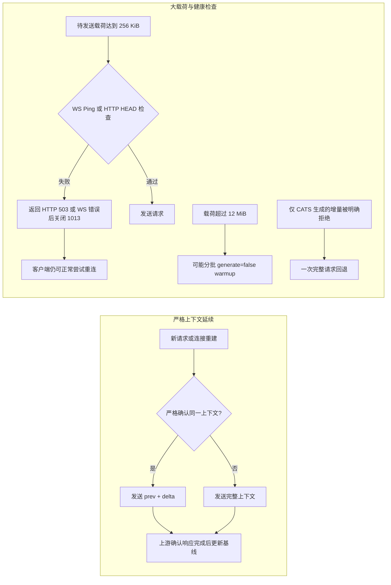

# Codex Against Traffic Spam（CATS）

[English](README.en.md)

> 让大猫少搬几箱上下文砖，但不替它猜下一句。

CATS 是一个面向 Windows x64 的本地网关伴侣，用于在官方 Codex Desktop 的模型流量中识别可以安全延续的上下文，并减少重复搬运的大请求。它是实验性项目，**不是 OpenAI 官方网关、官方插件或官方产品**。默认安装的 CATS 只在本机回环地址提供入口，再连接真实上游；是否能省流量取决于上下文是否真的可以延续。

## 先看结论

- 目标是减少重复的大型上下文载荷，不承诺普遍提速或普遍节省。
- 原生短断线本身就可能通过 WebSocket 增量继续，CATS 并不对所有网络环境都有额外收益。
- 测试使用真实安装的官方 `codex.exe` 核心和真实 ChatGPT 上游，但测试链路是隔离观测 relay，**不是 Desktop GUI 端到端测试**。
- CATS 不记录聊天图片或账号令牌；本地 metrics 只记录大小、数量和原因等统计；安装状态保存本地随机入口 token。用于恢复的配置备份可能含用户配置，应按私密文件保管。

## 安装

1. 在 Windows x64 上安装官方 Codex Desktop，并使用 ChatGPT 账号登录。
2. 下载本项目 ZIP，解压到一个本地目录。
3. 双击 `INSTALL.cmd`。

安装器不要求系统 Python，不修改系统 PATH、代理或证书；会为当前用户注册 CATS 专用启动项和计划任务。它会在本地安装目录中使用固定版本并校验 SHA-256 的私有嵌入式 Python 3.14.9 与 pip，再从 PyPI 安装固定依赖。整个 runtime 随项目安装，不依赖可能被升级或删除的共享 Python。

当前固定依赖为 `aiohttp 3.14.5`、`websockets 16.1.1`、`zstandard 0.25.0`、`tomlkit 0.13.3`、`multidict 7.1.0` 和 `yarl 1.25.1`。

首次安装已有 Codex 时，需要重启已经打开的 Codex 才能加载新配置。安装启用登录自启和任务恢复，但未验证真实注销登录周期，也不会拦截每次启动 Codex 的动作；需要时可使用 `START-GATEWAY.cmd` 或 `OPEN-CODEX.cmd`。`OPEN-CODEX.cmd` 会先启动网关，再打开 Codex。源码目录和本地安装目录都提供同样的命令入口。

安装器会拒绝自动配置自定义 provider、profile/base URL、`OPENAI_BASE_URL` 覆盖、PAC、SOCKS，或带凭据的代理。可识别的现有无凭据 HTTP(S) 代理会沿用；原代理与证书不会被修改。

## 命令入口

| 文件 | 用途 |
| --- | --- |
| `START-GATEWAY.cmd` | 启动本地网关 |
| `STOP-GATEWAY.cmd` | 停止本地网关 |
| `OPEN-CODEX.cmd` | 先启动网关，再打开 Codex |
| `STATUS.cmd` | 查看应用层状态、网关健康状态和 metrics 摘要 |
| `DOCTOR.cmd` | 运行诊断 |
| `UNINSTALL.cmd` | 停止并卸载，恢复原 Codex 配置 |

`STATUS.cmd` 报告的是应用层状态，不是网络可达性证明。执行 `STOP-GATEWAY.cmd` 或 `UNINSTALL.cmd` 后，如果 Codex 当时已经打开，请重启 Codex 使配置恢复生效。

## 失败恢复

安装先在隔离暂存目录中下载 runtime、安装依赖并执行导入和桌面命令 smoke test。依赖或 smoke test 失败时，已有安装不会被替换；提交或激活阶段失败时，会尝试恢复旧 runtime 和旧配置。

自动恢复本身也可能受到文件占用或权限问题影响。若恢复失败，安装目录会被保留以便诊断，不应把它当作“已经成功安装”；请先用 `DOCTOR.cmd` 检查并保留目录中的诊断信息。配置备份可能包含用户配置，分享前应视为私密。

## 上下文延续规则

只有同一账户与会话、模型与工具配置一致、历史严格匹配，而且同一上游 WebSocket 仍存活并已确认上一响应完成时，才发送 `previous_response_id + 增量 input`；无法确认时发送完整上下文。对于客户端重新提交的完整历史，连接重建后的首次请求仍须全量，不能把原生请求中的 `previous_response_id` 直接算作 CATS 节省。服务器是否能跨连接复用缓存也没有保证。

健康检查只证明探测时刻的连接状态，不能保证随后发送一定成功。探测失败时，CATS 返回 HTTP 503，或通过 WebSocket 返回错误并以 1013 关闭；不会阻止客户端继续重连，也不会自动追加一次完整上传。HTTP 探测使用不含请求体的 HEAD；带正文签名的请求不会被擅自探测或改写。超过 12 MiB 的请求可能需要分批 `generate=false` warmup。仅当 CATS 自己生成的增量在首个上游事件被明确以 `previous_response_not_found` 拒绝时，才完整重试一次；不对不确定结果盲目重试。

这些探测、warmup 和明确拒绝后的重试是有意增加的协议操作。除此之外，原生 HTTP 转发不会主动增加压缩、Cookie、自动跳转或额外正文。HTTP 转 WebSocket 会改变传输封装，无法保证所有任意请求头、未知 WebSocket 控制消息或子协议均等价；兼容性仍有边界。上下文基线仅保存在内存，过期、重启或连接失效均会放弃复用；不依靠删除历史图片省流量。

## 一次隔离实测

下面的结果来自一组配对实验：两组各执行一次，使用相同的 3 张不同 PNG（合计 Base64 上下文约 10.8 MB），共 4 代；首代完成后隔离上游 12 秒。实验没有强制禁用 WebSocket，两组都自然回退到 HTTP，4 代均成功，工具调用 3 次和回忆色块检查均通过。提示词不包含颜色答案。测试日期为 2026-10-22；Desktop 26.1016.6573.0、核心 0.163.0-alpha.11、模型 `gpt-6-astra`（low reasoning）。

- 本机到 Clash 链路的 TLS + CONNECT 字节数：原生 `32,438,227 B`，CATS `16,552,902 B`，减少 `48.97%`。该数字包含握手、重试和压缩差异；这是本机到 Clash 的链路观测，不是 WAN 或网卡流量结论。
- 四次已完成生成的规范化未压缩 JSON 载荷：原生 `43,226,845 B`，CATS `21,584,719 B`，约减少 `50.07%`。客户端仍会把完整 HTTP 请求交给本地 CATS；节省发生在 CATS 到上游这一段。HTTP 请求体使用 zstd，上游 WebSocket 协商 permessage-deflate，不能把未压缩载荷当作线上字节。
- 后两次增量载荷为 `2,480 B` 和 `2,505 B`；重建后的第一次请求仍是全量，随后可以把客户端的完整 HTTP 请求转换为同一条上游 WebSocket 上的增量请求。
- 原生短断线也可能自行恢复 WebSocket 增量，因此这组单次配对结果不能推广为所有网络环境的固定收益。

实验使用的是官方已安装的 `codex.exe` 核心和真实 ChatGPT 上游，测试 harness 是隔离 relay，不应套用为 Desktop GUI 已完成同等验证。模拟 server 测试可以通过，但也不替代 GUI 验证。

| 指标 | 原生 Codex | CATS |
| --- | ---: | ---: |
| 代理链路上行（TLS + CONNECT） | 32.44 MB | 16.55 MB |
| 已完成生成的规范化未压缩 JSON 载荷 | 43.23 MB | 21.58 MB |
| 第三次生成的应用载荷 | 10,822,938 B | 2,480 B |
| 第四次生成的应用载荷 | 10,824,191 B | 2,505 B |
| 完成生成 / 图片回忆检查 | 4 / 通过 | 4 / 通过 |

应用载荷按紧凑 UTF-8 JSON 统一统计，不等于原始 HTTP 字节或压缩后线缆字节。以上 MB 均为十进制。离线失败的连接尝试不等于已向服务器上传完整正文。原生首代已使用自己的 `previous_response_id`，这部分没有算成 CATS 优势。一次配对实验不足以证明长期收益或质量完全等价。

## 验证范围

**模拟服务器验证通过：**严格延续、跨传输复用、隔离、回退和保真回归；不代表官方服务的所有行为。

**真实官方环境验证通过（核心程序，非 GUI）：**上述配对实验的 HTTP/WS 路径、工具调用、连接故障恢复及三张历史图片色块回忆。

当前构建与离线验证已通过：131 项自动化测试、PowerShell 离线检查、全新嵌入式 Python 3.14.9 runtime 的 wheel 安装、模块导入、`pip check` 和 `python -m uplink12.desktop --help`。

**尚未验证：**原生 History UI 的搜索与图片读取、账号真实切换、新安装端到端流程、注销后重新登录，以及主观输出质量。请把这些项目视为未承诺行为。

## 隐私与边界

- 本地入口使用带随机 mount token 的明文 HTTP loopback。它能防止普通误连，但不能把同一台机器上的恶意进程隔离在外。
- CATS 不记录聊天文本、图片、账号 token 或 Cookie；metrics 只含载荷大小、数量、传输及原因等统计。安装状态包含本地随机入口 token，需要按私密数据保管。
- 安装备份用于恢复 Codex 配置，可能包含用户配置，必须按私密数据处理。
- CATS 不修改系统代理或证书，也不把自定义 provider、base URL、PAC、SOCKS 或带凭据代理自动改写成可用配置。

## 共同作者

[hadwr](https://github.com/hadwr) 的共同作者署名已保留在初始提交中。

## 许可证与素材

代码许可证见 [LICENSE](LICENSE)，MIT 只适用于代码。`assets/cat.png` 是用户提供的原图，来源和授权状态仍待确认；猫图不随代码作 MIT 授权声明。
