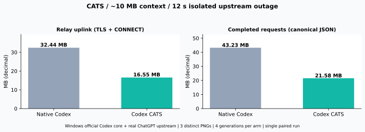
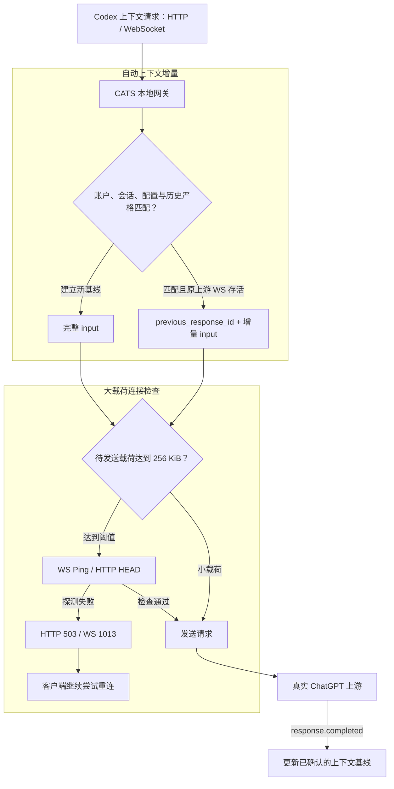

# Codex Against Traffic Spam (CATS)

<p align="center">
  
</p>

<p align="center"><strong>拯救你的codex代理流量</strong></p>

<p align="center">
  
  
  <a href="LICENSE"></a>
</p>

<p align="center">
  <a href="README.en.md">English</a> ·
  <a href="#安装与使用">安装与使用</a>
</p>

CATS 是面向 Windows 官方 Codex Desktop 的实验性本地网关伴侣，通过复用服务器已确认的上下文和连接探测，减少多模态上下文与消息的重复上行，拯救你的带宽和代理流量。

## 为什么需要 CATS？

长会话中的完整历史重发，会让相同的多模态上下文再次占用代理流量。CATS 统一处理 HTTP 与 WebSocket 上下文请求，在账户、会话、配置和历史严格匹配时，把完整请求转换为 `previous_response_id + 增量 input`；其他情况完整转发输入，建立新的上下文基线。

断线重连、传输回退、会话恢复等情况都可能触发历史图片与文件内容的重复上行。CATS 面向这些重复上传场景，统一根据请求内容与已确认的服务器上下文判断复用，支持 HTTP 与 WebSocket；满足延续条件时发送增量，较大载荷发送前检查连接状态。

## 核心能力

- **自动上下文增量**：Codex在某些情况会触发不必要的上下文全量上传。CATS在HTTP 与 WebSocket 入口共用严格的延续判定，复用同一上游连接中已确认完成的上下文。
- **大载荷连接检查**：代理服务器和Codex断连后，重复上传依然会消耗代理流量。CATS在发送较大载荷前执行 WS Ping 或 HTTP HEAD；探测失败时返回重试信号，交由客户端继续重连。
- 
## 实测：约 10.8 MB 图片上下文

使用 **3 张不同 PNG**，合计 Base64 上下文约 **10.8 MB**，对比原生请求透传与 CATS 在连接中断、恢复及后续请求中的上行流量，两组各完成 4 次生成。



| 指标 | 原生请求透传对照 | CATS | **流量减少** |
| --- | ---: | ---: | ---: |
| 代理观测链路上行（TLS + CONNECT） | 32.44 MB | 16.55 MB | **48.97%** |
| 已完成生成的规范化 JSON 载荷 | 43.23 MB | 21.58 MB | **50.07%** |
| 第三次生成的 JSON 载荷 | 10,822,938 B | 2,480 B | **99.98%** |
| 第四次生成的 JSON 载荷 | 10,824,191 B | 2,505 B | **99.98%** |

## 工作原理



上下文基线保存在内存中。客户端连接变化时，CATS 检查现有上游连接与基线；上游连接重建后，通过完整输入重新建立基线，再继续判断后续增量。

健康检查反映探测时刻的连接状态。失败时，HTTP 返回 503，WebSocket 返回错误并以 1013 关闭，客户端可继续重连。超过 12 MiB 的请求可能通过分批 `generate=false` warmup 准备上下文；CATS 生成的增量在首个上游事件被明确以 `previous_response_not_found` 拒绝时，完整重试一次。

HTTP 转 WebSocket 会转换传输封装；其他原生端点保留原请求路径。带正文签名的 HTTP 请求使用原生转发路径。完整图片内容与历史输入始终作为转发和延续判定的基准。

## 安装与使用

**必须项**：Windows x64、PowerShell 5.1+、Git；官方 Codex Desktop 已通过 ChatGPT 登录，使用默认 OpenAI 提供方；网络采用直连或无凭据 HTTP(S) 代理。

在 PowerShell 中执行：

```powershell
git clone https://github.com/Khiyyya/codex-cats.git
cd codex-cats
powershell.exe -NoProfile -ExecutionPolicy Bypass -File .\scripts\windows.ps1 -Action install
```

安装器自动准备独立 Python 环境、识别 Codex、配置网关和当前用户登录自启。安装后重启 Codex。

### 管理入口

在项目目录或安装目录中运行对应文件：

| 入口 | 功能 |
| --- | --- |
| `INSTALL.cmd` | 安装或更新 |
| `OPEN-CODEX.cmd` | 启动网关并打开 Codex |
| `START-GATEWAY.cmd` | 启动网关并启用接入 |
| `STOP-GATEWAY.cmd` | 恢复接入配置并停止网关 |
| `STATUS.cmd` | 查看状态与应用层载荷统计 |
| `DOCTOR.cmd` | 检查环境、自启与代理连通性 |
| `UNINSTALL.cmd` | 恢复配置、移除启动项并清理安装目录 |

停止或卸载后，重启 Codex 以加载恢复后的配置。
